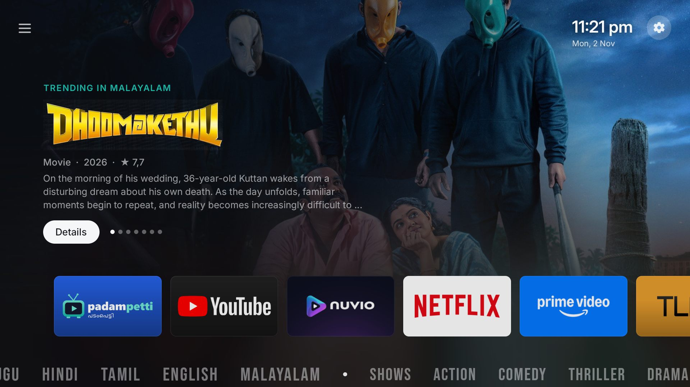
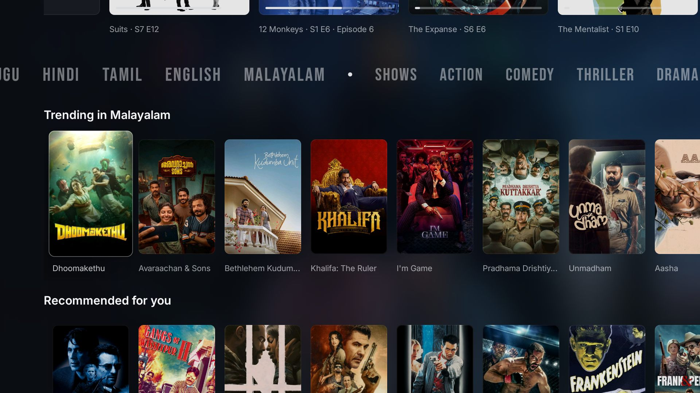
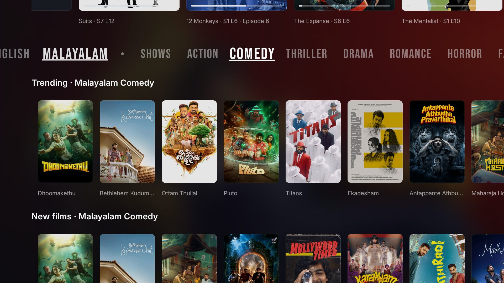
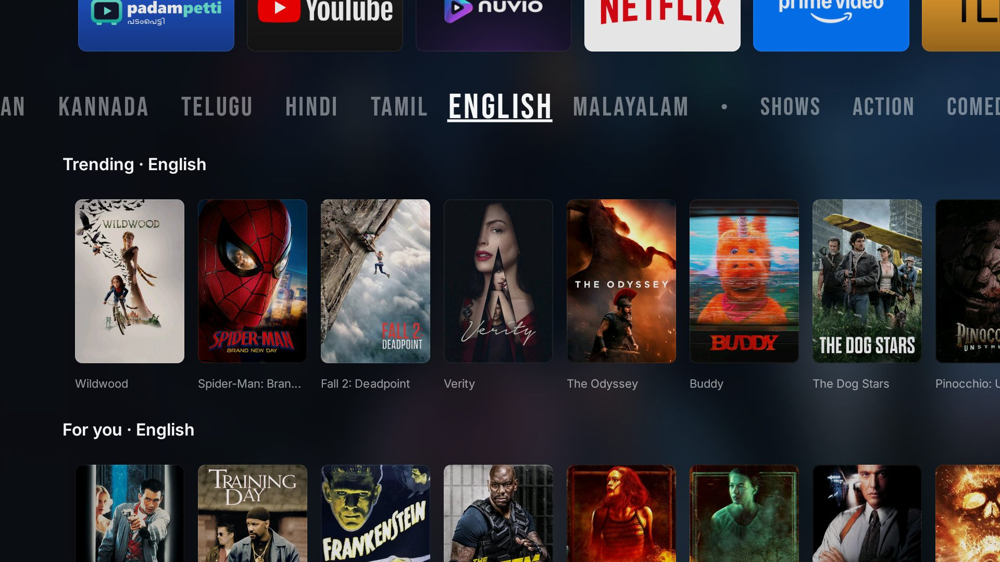
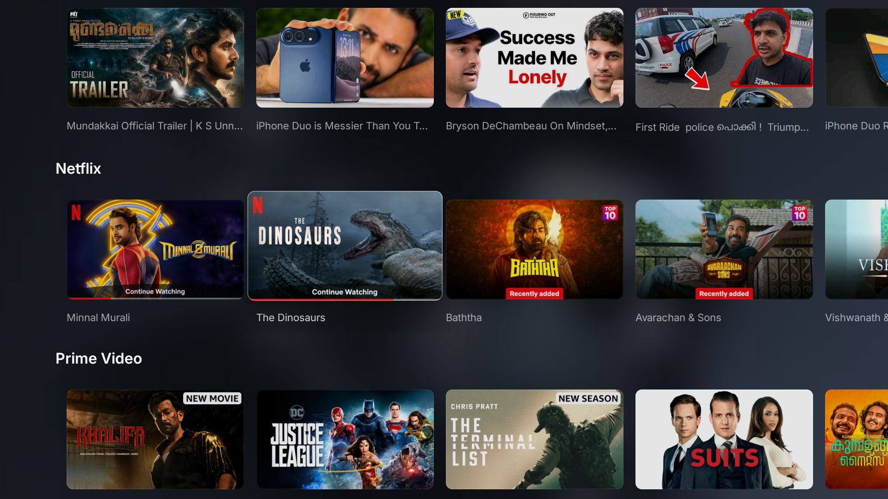

# MenaUllaTV UI

*Muriyo thodakkunnilla, TV engilum mena aayitt irikkatte.*

A clean, fast home screen for Google TV and Android TV, tuned for watching **Malayalam** films and shows: what's trending
in Malayalam, where each title streams, and one click to open it in the right app. No ads, no Google TV home screen.



MenaUllaTV UI is a fork of **[CleanYourTV UI](https://github.com/matheus-caldeira/cleanyourtv-ui)** by Matheus Caldeira,
which is itself built on [CleanYourTV](https://github.com/Gathin23/cleanyourtv) (it takes the factory bloat off your TV)
with the look of [Free My TV](https://github.com/simbasjungles/free-my-tv). Everything CleanYourTV UI does is still here;
its README is [`README.cleanyourtv-ui.md`](README.cleanyourtv-ui.md). This page covers what this fork changes.

## What's different

**Home, Malayalam first**
- A banner of what's trending, then your apps, Continue watching, and rows of Malayalam films: trending, your list,
  recommended for you, then a row for each streaming app on the TV (Netflix, Prime Video, then Sony LIV, …).
- A **language · genre bar** under Continue watching, in Netflix-style capitals (Bebas Neue): Malayalam, English, Tamil,
  Hindi, Telugu, Kannada… on the left of the dot, **Shows** (series with seasons and episodes) and the genres on the right.
  Pick one and the rows under it change in place; the focus stays on the word, so Left and Right flip through them.

- A **YouTube row** above the apps' rows: recent videos from picked channels (about a fifth Malayalam, the rest new
  songs, tech, trailers and podcasts), no Shorts, opened in TizenTube. It refreshes every 30 minutes and when the TV
  turns on. Your own channels can replace the picks (see [Configuration](#configuration)).

- A **clock** (12-hour by default) and a round **Home Settings** button at the top right, beside the menu button at the
  top left. All three show at the top of Home only and fade away as you scroll.
- Gone: "Because you watched…", "Malayalam on Netflix/Prime/Sony LIV", the anime row, the shortcuts row, and the glass
  panel behind the apps.

**Title pages**
- **Nuvio** on every title, in "Where to watch", beside the streaming services: it opens the title's own page in Nuvio.

**Remote and focus**
- Down from the banner always reaches the apps, Up from them the banner; arrows never land on the corner buttons by
  accident (only Up from the banner reaches them).
- The remote's Settings button: on some TVs (the Lumio here) the firmware takes it before any app sees it. Map it with
  Button Mapper to the TV's settings.

**Faster and lighter**, measured on a Lumio Google TV (Realtek, 2.7 GB RAM, 1080p) with the same browsing before and after:

| | Before | After |
|---|---|---|
| Median frame time | 46 ms (about 21 fps) | 20–22 ms |
| Janky frames | 15.5% | 4–7% |
| GPU time per frame (median) | 21 ms | 7–8 ms |
| Home's memory after browsing every row | 476 MB | 198 MB |
| Of which pictures | 363 MB | 84 MB |

How: pictures are decoded at the size they're shown (a 1280×720 channel picture in a 384×216 card used nine times the
memory), the banner's fade is drawn once instead of on every frame, fewer full-screen layers are painted, and YouTube
thumbnails are small. Focus moves with an Apple TV-like spring. On disk the app is 1.6 MB, against 25 MB for Google TV's
own home screen.

**Name**: the app shows as *MenaUllaTV UI* on the TV, and its Settings credit both projects.

## Screenshots

Taken on the TV (a Lumio Google TV, 1080p).

| | |
|---|---|
|  |  |
|  |  |
|  | |

## Install

Build, install and first-time setup are the same as CleanYourTV UI's: see
[`launcher-ui/README.md`](launcher-ui/README.md). In short, with ADB on a computer on the TV's Wi-Fi:

```bash
cd launcher-ui
ANDROID_HOME="$HOME/Android/Sdk" bash build.sh
adb connect <tv-ip>
adb install -r CleanYourTV-UI.apk
```

Then make it Home and push your `config.json` (it holds your TMDB key, which stays on your computer and your TV):

```bash
TV_HOST=<tv-ip> launcher-ui/config.sh my-config.json
```

## Configuration

Everything in CleanYourTV UI's [`config.json`](launcher-ui/README.md#configjson) still works. This fork adds:

| Key | What it does | Example |
|---|---|---|
| `youtube_channels` | Your own channels for the YouTube row, instead of the picks; mark Malayalam ones with `"ml": true` | `["UC…", {"id": "UC…", "ml": true}]` |
| `hidden_channels` | App channels never shown as rows, by name | `["Stream your library movies"]` |
| `clock` | `12h` (default), `24h` or `auto` | `"clock": "24h"` |

Your YouTube subscriptions' channel ids are in a [Google Takeout](https://takeout.google.com) export (YouTube →
subscriptions).

## Credits

- [CleanYourTV UI](https://github.com/matheus-caldeira/cleanyourtv-ui) by Matheus Caldeira, which this fork builds on.
- [CleanYourTV](https://github.com/Gathin23/cleanyourtv) and [Free My TV](https://github.com/simbasjungles/free-my-tv).
- Data from [TMDB](https://www.themoviedb.org) (this product uses the TMDB API but is not endorsed or certified by TMDB)
  and YouTube's public channel feeds.
- Fonts: Inter and Bebas Neue, under the SIL Open Font License ([`NOTICE`](launcher-ui/NOTICE)).

MIT License, as the original: see [`LICENSE`](LICENSE).
